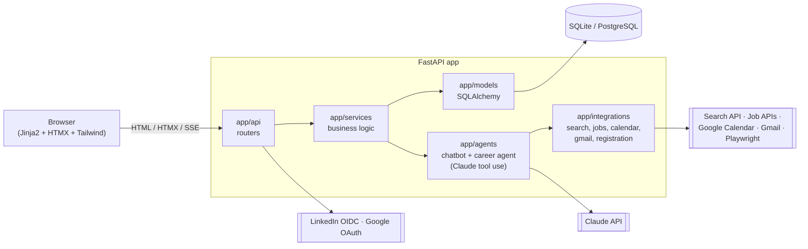

# AI-Career-Helper

ILT Final Project Code. **AI Career Helper** is an AI-powered web application that acts as a
personal career coach. It takes a student or job seeker from *"where am I now?"* to *"what should I
do next, and where can I apply?"*

> AI recommendations are guidance, not guarantees. No external action (calendar, registration,
> email) happens without the user's explicit approval.

## Build status

| Phase | Scope | Status |
|------:|-------|--------|
| 1 | Project skeleton, DB models, auth (email + LinkedIn + Google), profile page | ✅ done |
| 2 | Chatbot: status, experience extraction (CV upload), constraints, level assessment | ⏳ |
| 3 | Gap analysis + three-stage roadmap | ⏳ |
| 4 | Resource search and ranking | ⏳ |
| 5 | Google Calendar + approved auto-registration | ⏳ |
| 6 | Quizzes / coding tasks, scoring, stage progression | ⏳ |
| 7 | Job matching (legal providers + LinkedIn search links) | ⏳ |
| 8 | Career agent: profile optimizer, CV generator, approval queue | ⏳ |
| 9 | Recruiter outreach via Gmail with safety limits, application tracker | ⏳ |
| 10 | Testing, Docker, CI, README, demo script | ⏳ |

## Tech stack

Python 3.11+, FastAPI, Pydantic v2, SQLAlchemy 2 (async) + Alembic, SQLite (dev) / PostgreSQL
(prod), Jinja2 + HTMX + Tailwind (mobile-first), Anthropic Claude API (`CLAUDE_MODEL`), Authlib
(LinkedIn OpenID Connect, Google OAuth 2.0), bcrypt + JWT in httpOnly cookies, Fernet-encrypted
OAuth tokens, pytest + ruff + mypy, Docker.

## Quick start (Windows / macOS / Linux)

```bash
python -m venv .venv
# Windows:  .venv\Scripts\activate      macOS/Linux:  source .venv/bin/activate
pip install -r requirements.txt
cp .env.example .env            # then edit values (all optional for a local demo)
python -m scripts.seed --demo   # skill taxonomy + demo@example.com / demo12345
uvicorn app.main:app --reload
```

Open http://localhost:8000. API docs are at http://localhost:8000/api/docs.

Run the tests and linters:

```bash
pytest -q
ruff check app tests scripts
```

### With Docker (PostgreSQL)

```bash
cp .env.example .env
docker compose up --build
```

The container runs `alembic upgrade head`, seeds the taxonomy, and starts Uvicorn on port 8000.

## Environment variables

See [.env.example](.env.example). The important ones:

| Variable | Purpose |
|----------|---------|
| `SECRET_KEY` | Signs JWTs and the session cookie. Use a long random value. |
| `TOKEN_ENCRYPTION_KEY` | Fernet key that encrypts OAuth tokens at rest. Required in production. |
| `DATABASE_URL` | `sqlite+aiosqlite:///./data/dev.db` or `postgresql+asyncpg://…` |
| `AUTO_CREATE_TABLES` | `true` for local dev. Set `false` and use Alembic in production. |
| `ANTHROPIC_API_KEY`, `CLAUDE_MODEL` | Claude API key and model id (default `claude-opus-5-5`). |
| `LINKEDIN_CLIENT_ID/SECRET` | "Sign in with LinkedIn" (OpenID Connect). Redirect: `{BASE_URL}/auth/linkedin/callback` |
| `GOOGLE_CLIENT_ID/SECRET` | Google sign-in. Calendar/Gmail scopes are requested later, only when needed. Redirect: `{BASE_URL}/auth/google/callback` |

Generate a Fernet key:

```bash
python -c "from cryptography.fernet import Fernet; print(Fernet.generate_key().decode())"
```

## Architecture



```
app/
  api/           routers: auth (pages + JSON + OAuth), me (JSON), pages (HTML), health
  core/          config, database, security (bcrypt/JWT), crypto (Fernet), rate limit, deps
  models/        24 tables: User, Profile, Skill, UserSkill, Certificate, Experience, Project,
                 Document, Roadmap, Stage, Resource, CalendarEvent, Registration, Quiz,
                 QuizAttempt, JobPosting, JobMatch, OutreachMessage, ApprovalRequest, AuditLog, ...
  schemas/       Pydantic request/response models
  services/      auth, profile, audit
  agents/        Claude client (prompts/ holds versioned prompt files)
  integrations/  OAuth clients (search/jobs/calendar/gmail/registration in later phases)
  templates/     Jinja2 pages + HTMX partials
  static/        CSS / JS
alembic/         migrations
data/            taxonomy.json (skills + target roles + required levels)
scripts/seed.py  idempotent taxonomy seed (+ --demo user)
tests/           pytest suite
```

## Security and privacy (Phase 1)

- Passwords are hashed with bcrypt. JWT access and refresh tokens live in httpOnly, SameSite=Lax cookies.
- OAuth tokens are encrypted at rest with Fernet.
- Login and register endpoints are rate-limited. Redirect targets are restricted to same-site paths.
- Every login, registration, profile change and account deletion is written to the audit log.
- Users can delete their account and all data from Settings (GDPR-style erasure).
- LinkedIn is used only for official "Sign in with LinkedIn". There is no scraping and no unofficial API.

## Demo (Phase 1)

1. Run the seed with `--demo`, start the server, and open the home page.
2. Register a new account, or log in as `demo@example.com` / `demo12345`.
3. Edit the profile: status, target role, weekly hours, goal date, budget.
4. Add a certificate, an experience and a project from the profile page. The lists update in place.
5. In Settings, change the password, view the connected accounts, and try account deletion.
